# MamaSafe Rwanda: Maternal Referral Ambulance Dispatch with Reinforcement Learning

<p align="center">
  
  
  
  
  
  
</p>

**A reinforcement learning dispatcher that decides which ambulance should carry a mother in an obstetric emergency, and to which hospital.**

When a mother at a rural health centre develops a complication (haemorrhage, obstructed labour, foetal distress), the health centre cannot treat her and must refer her to a hospital. Someone has to choose an ambulance and a destination quickly, while beds, surgical theatres, neonatal units, weather and the other ambulances all keep changing. This project turns that job into a 30-day simulation. Four agents (DQN, REINFORCE, PPO and A2C) learn the job with **TorchRL**, and a **Three.js** 3D world shows the trained agent at work.

<p align="center">
  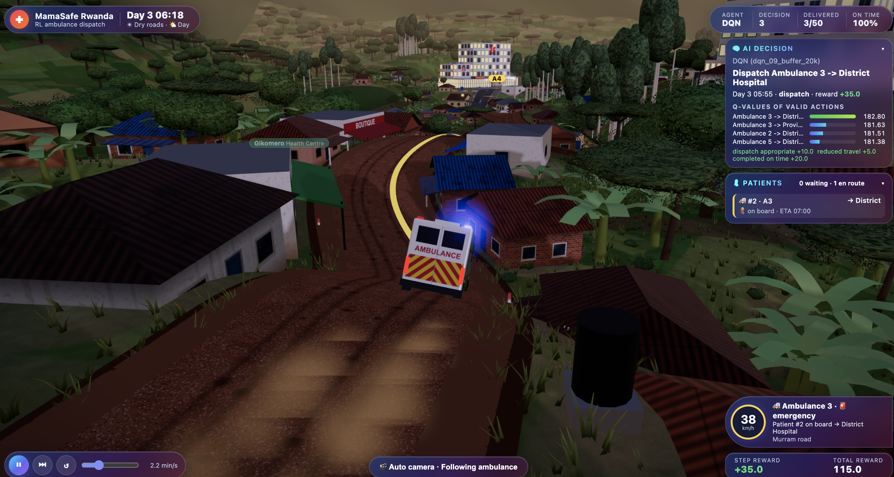
  <br><em>The DQN agent sent Ambulance 3 to Rubona Health Centre. The ambulance now carries patient #2 down a murram road towards the District Hospital on the hill.</em>
</p>

**Contents:**
[The problem](#the-problem) ·
[Why RL](#why-reinforcement-learning) ·
[Quick start](#quick-start) ·
[The 3D simulation](#the-3d-simulation) ·
[Environment](#the-environment) ·
[Training](#training) ·
[Results](#results) ·
[API](#http-api) ·
[Project structure](#project-structure) ·
[Limitations](#limitations)

---

## The problem

Rwanda's referral chain runs from health centres to district hospitals and then to provincial referral hospitals. In a maternal emergency, the delay that kills is often the second one: **getting from the health centre to a hospital that can actually treat her**. Three things make this hard:

* **Ambulances are shared.** A district has only a few ambulances, and they are also called out for general emergencies.
* **Hospitals are not all equal.** Some cannot do surgery on a given day, some have no neonatal unit, and beds fill up for days.
* **Roads change.** Murram and rough roads slow down a lot in rain and at night.

The agent plays the role of the district dispatcher. Each time a referral is waiting, it chooses **one ambulance and one hospital**, or decides to **wait**.

### One referral, start to finish

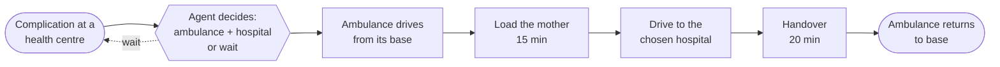

The agent makes the decision once. The consequences (travel time, whether she arrives on time, which beds stay occupied, which areas lose ambulance cover) play out over the following hours and days.

<p align="center">
  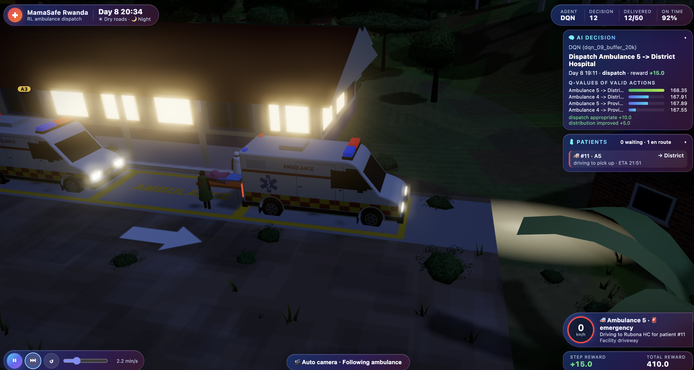
  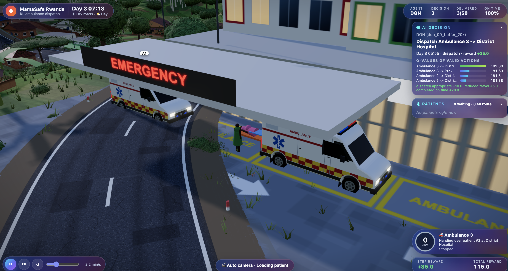
  <br><em>Left: loading a patient at a health centre at night. Right: handover at the District Hospital emergency bay.</em>
</p>

## Why reinforcement learning

A simple rule like "always send the closest free ambulance" works most of the time, but it cannot see the future. Each dispatch changes the state that every later decision depends on:

* **Coverage.** Sending the only ambulance near Mubuga leaves that whole area without cover for 3 to 4 hours. If a critical case appears there next, she waits.
* **Beds.** A patient admitted today keeps a bed for 0.5 to 3 days. Filling the District Hospital with moderate cases can block the next critical one.
* **Capability.** Surgery and neonatal units go down on some days, so the "nearest" hospital may not be a valid one.
* **Delayed outcome.** The +20 reward for an on-time arrival comes hours after the dispatch decision, and an unresolved referral is only penalised after 8 hours of waiting.

These are **sequential decisions with delayed, shared consequences**. A one-shot classifier or a shortest-path router cannot weigh them. An agent that learns from whole 30-day episodes can.

## Quick start

You only need [uv](https://docs.astral.sh/uv/). It downloads Python 3.11 and installs every dependency from `pyproject.toml` and `uv.lock`.

```bash
# install uv once
# macOS / Linux:         curl -LsSf https://astral.sh/uv/install.sh | sh
# Windows (PowerShell):  powershell -ExecutionPolicy ByPass -c "irm https://astral.sh/uv/install.ps1 | iex"

git clone https://github.com/mukunzindahiro-max/james_mukunzi_rl_summative.git
cd james_mukunzi_rl_summative
uv sync
uv run main.py
```

`uv run main.py` loads the best trained agent (DQN), opens the 3D simulation at `http://127.0.0.1:8000` and prints every decision in the terminal. The trained models are already in `models/`, so you don't need to train anything first.

### All commands

| Command | What it does |
|---|---|
| `uv run main.py` | 3D simulation with the best agent (DQN) and a verbose terminal log |
| `uv run main.py --policy ppo` | watch another agent: `dqn`, `reinforce`, `ppo`, `a2c`, `nearest`, `random` or `manual` |
| `uv run main.py --scenario rainy_season` | harder scenario: 80% rainy days and more general-duty calls |
| `uv run main.py --seed 10005` | another held-out episode |
| `uv run main.py --port 8080 --no-browser` | different port, don't open the browser automatically |
| `uv run main.py terminal` | one episode in the terminal only |
| `uv run main.py terminal --show-state` | also print the full state (ambulances, beds, units) after each step |
| `uv run main.py baselines` | evaluate the random and nearest-ambulance baselines |
| `uv run main.py train-dqn` | train the 12 DQN experiments |
| `uv run main.py train-pg` | train the REINFORCE, PPO and A2C experiments |
| `uv run main.py compare` | pick the best run per algorithm, run the seed-robustness check, write `logs/comparison.json` and the figures |
| `uv run pytest -q` | run the test suite (22 tests) |

### What the terminal shows

Every decision is printed on one line: step, simulated clock, the referral (priority, health centre, needs), the action, the outcome, the reward, the running total, and how many patients have been delivered and how many on time.

```text
[      DQN] step  10 | Day 8 04:01 | #9  critical @ Nyakabanda Health Centre needs surgery          | Dispatch Ambulance 4 -> District Hospital            | dispatch  | reward   +55.0 | total    360.0 | done 10/50 on-time 10
[      DQN] step  19 | Day 10 11:41 | #18 critical @ Mubuga Health Centre     needs surgery+neonatal | Dispatch Ambulance 1 -> Provincial Referral Hospital | dispatch  | reward   +75.0 | total    645.0 | done 19/50 on-time 17
...
Episode finished: return 1733.8 | completed 50 | on time 47 (94.0%) | unresolved 0 | mean wait 1.2 min | mean referral time 105.8 min | ambulance utilization 16.6% | km 3349
Admissions per hospital: {'District': 29, 'Eastern Rural': 17, 'Provincial': 4}
```

## The 3D simulation

The frontend is built with Three.js and served by FastAPI (`environment/rendering.py` and `environment/web/`). The Python environment is the single source of truth: the browser only draws the state it receives. It shows a hilly rural district with five health centres, three hospitals, paved, murram and rough roads, villages, banana and eucalyptus trees, day and night lighting, and rain.

<p align="center">
  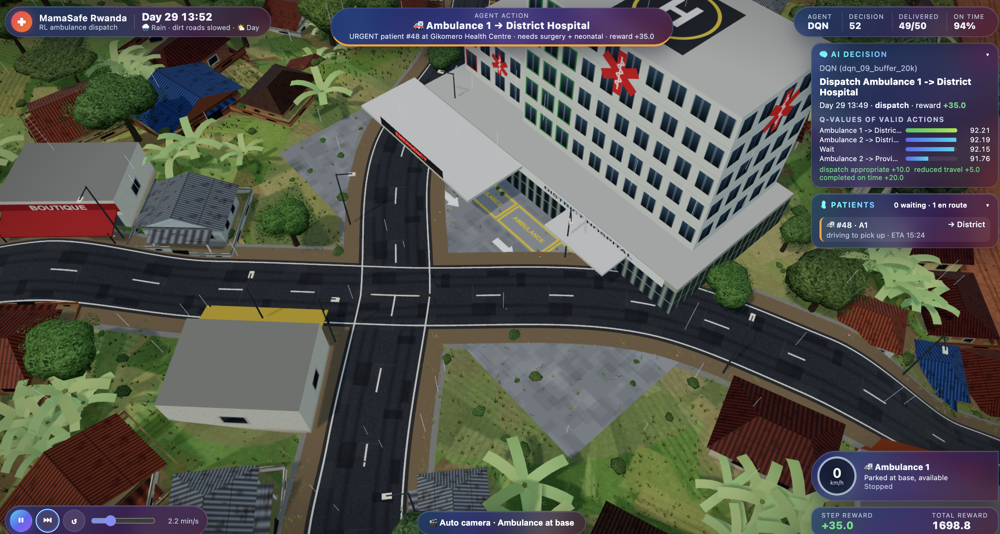
  <br><em>Aerial view of the District Hospital in the rain. The banner at the top shows the agent's latest action: an urgent patient at Gikomero Health Centre who needs surgery and neonatal care is sent to the District Hospital.</em>
</p>

**On screen:**

* **Top left:** simulated day and clock, road condition (dry or rain) and day or night.
* **Top right:** agent name, number of decisions, patients delivered and on-time rate.
* **AI decision panel:** the decision the agent just made, its reward broken into parts (`dispatch appropriate +10`, `reduced travel +5`, ...), and the **Q-values of every valid action**, so you can see why DQN chose what it did.
* **Patients panel:** referrals that are waiting or on the road, with their ambulance and ETA.
* **Bottom right:** the followed ambulance's speed, task and road type, plus the step reward and total reward.
* **Bottom left:** pause, single step, restart and simulation speed.
* **Route line:** a coloured line shows the road the ambulance will take to the hospital.

**Camera:** the automatic camera follows the ambulance on the current mission and moves smoothly between ambulances. Keys: `C` switches camera mode, `N` follows the next ambulance, `H` hides the panels, `Space` pauses.

### Conditions you can see

| Day | Night |
|---|---|
| 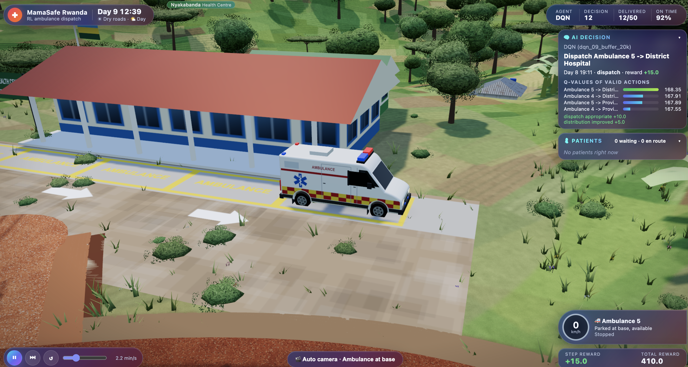 | 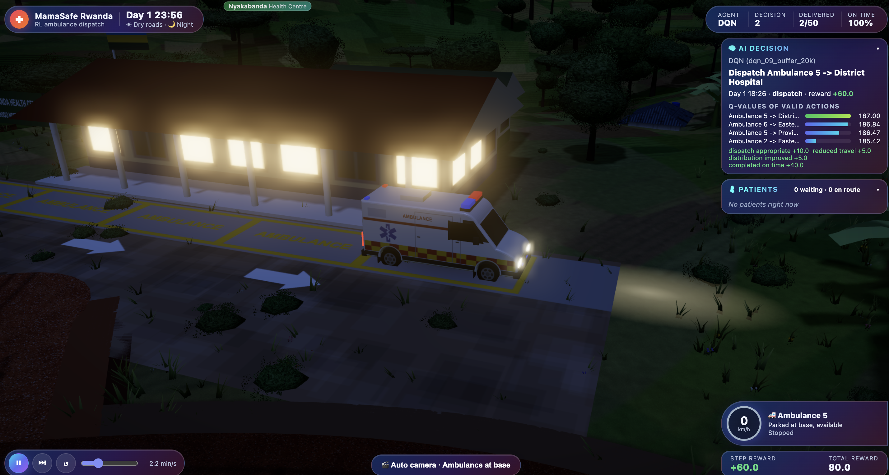 |
| **Dawn, on the road** | **Night, on the road** |
|  | 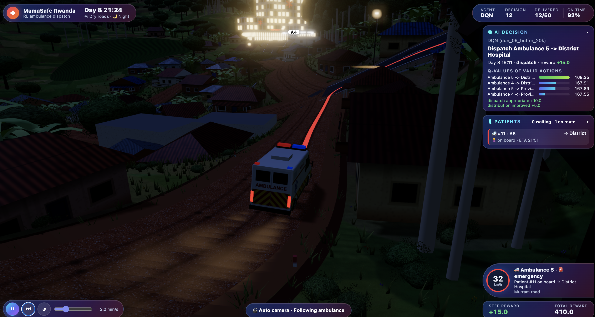 |
| **Rain at night** | **Rain by day** |
| 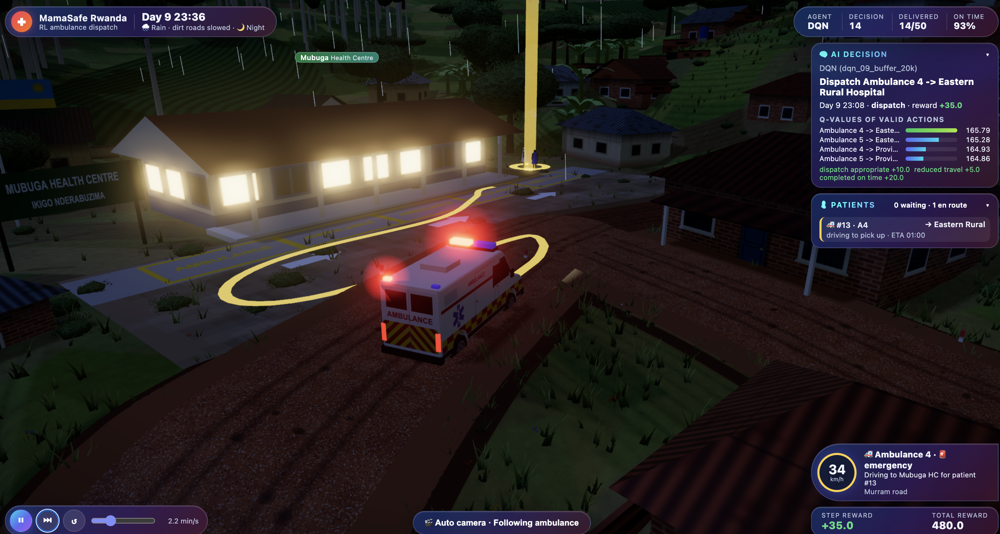 | 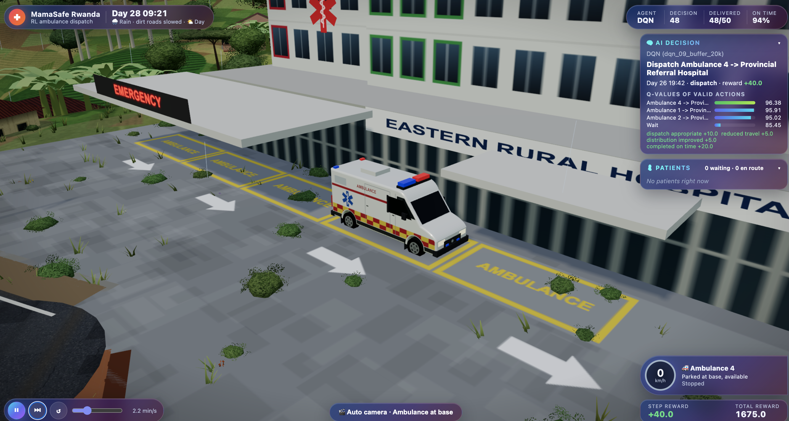 |

### Busy periods and the end of an episode

<p align="center">
  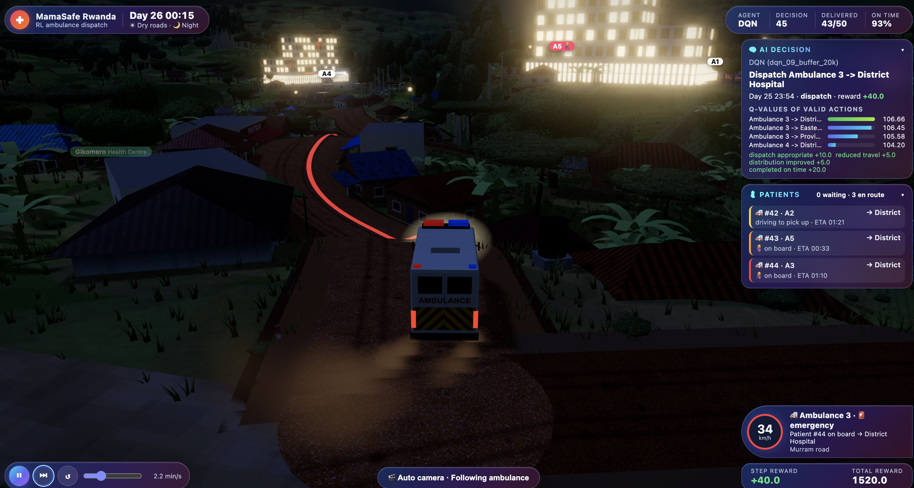
  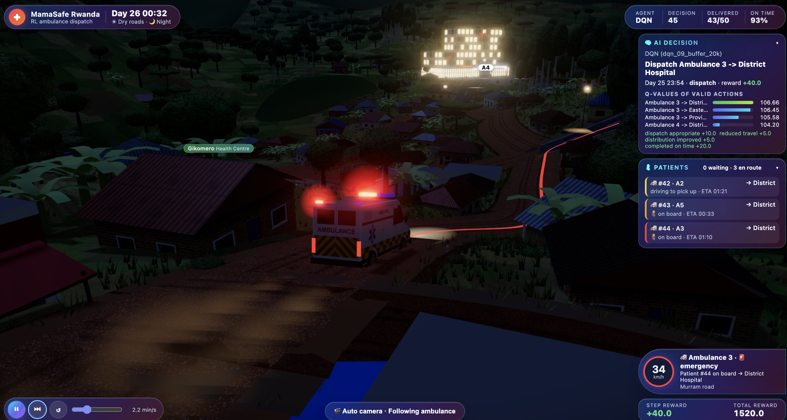
  <br><em>Day 26 after midnight: three patients on the road at once, with two already on board. The agent must keep the remaining ambulances spread out.</em>
</p>

<p align="center">
  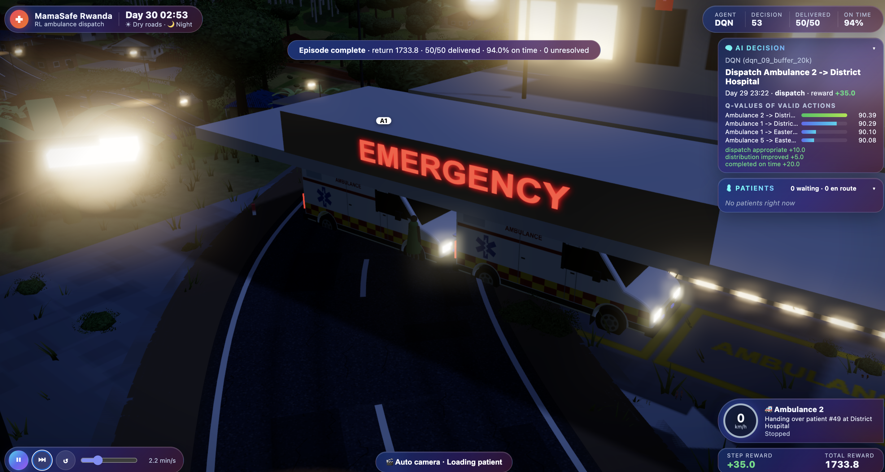
  <br><em>End of the 30-day episode on held-out seed 10000: 50 of 50 mothers delivered, 94% on time, none left unresolved.</em>
</p>

More views: [ambulance at base at dawn](assets/environment_ambulance_at_base_dawn.png) · [ambulance back at base after a trip](assets/environment_ambulance_returned_night.png).

## The environment

`environment/custom_env.py` defines `MaternalReferralEnv`, a [Gymnasium](https://gymnasium.farama.org/) environment.

**Map.** A 40 × 30 km district modelled as a road graph: 5 health centres, 3 hospitals and 8 junctions, joined by 23 roads of three types.

| Road | Speed | Rain factor | Night factor |
|---|---|---|---|
| paved | 55 km/h | × 0.9 | × 0.8 |
| murram | 30 km/h | × 0.6 | × 0.8 |
| rough | 18 km/h | × 0.4 | × 0.8 |

Travel times are precomputed with Floyd–Warshall for the four conditions (dry/rain × day/night), and ambulances follow the fastest route for the conditions at departure.

| Hospital | Beds | Surgery | Neonatal |
|---|---|---|---|
| District Hospital | 6 | yes | yes |
| Eastern Rural Hospital | 4 | yes | **no** |
| Provincial Referral Hospital | 8 | yes | yes |

Each day, a surgical theatre is down with 8% probability and a neonatal unit with 10%. Hospitals also have background patients who take up part of their beds.

**Time.** The environment is **event-driven**. It does not tick every minute. It jumps to the next moment a decision is needed (a referral is waiting) and asks the agent. One episode covers **30 days and 50 referrals**, which is usually 50 to 60 decisions.

### Actions (16, discrete)

| Action | Meaning |
|---|---|
| `0` | **Wait.** Dispatch no one. Time moves to the next useful moment: an ambulance becomes free, a bed is released, a new referral arrives, or a wait threshold is reached. |
| `1 + 3·a + h` | **Dispatch ambulance `a` (0–4) to hospital `h` (0–2).** 5 ambulances × 3 hospitals = 15 actions. |

Every action maps to a real dispatcher's choice: "send ambulance X, take her to hospital Y" or "hold". An **action mask** comes with every observation and marks invalid choices: a busy ambulance, a hospital without the required unit, or a hospital with no free bed. All four agents use the mask, so they only ever pick valid actions. If an invalid action is forced anyway (for example from the API), it is penalised.

### Observations (72 numbers + 16-value action mask)

All values are scaled to [−1, 1]. Everything comes from the simulator state at the moment the decision is needed.

| Index | Meaning | Encoding |
|---|---|---|
| 0 | a referral is waiting | 0 or 1 |
| 1–3 | priority: critical, urgent, moderate | one-hot |
| 4–8 | origin health centre | one-hot (5) |
| 9–10 | needs surgery / needs neonatal care | 0 or 1 |
| 11 | how long she has waited | minutes / 480 |
| 12–41 | **per ambulance** (5 × 6): free now; x and y position; time until free; time to reach her (busy time + drive); road distance from base to her | 0/1, km / 40, km / 30, min / 240, min / 240, km / 60 |
| 42–59 | **per hospital** (3 × 6): free beds; occupancy; surgery ready today; neonatal ready today; drive time from her health centre; suitable and has a bed | fraction, fraction, 0/1, 0/1, min / 240, 0/1 |
| 60 | referrals waiting | count / 10 |
| 61–62 | mean and longest wait among waiting referrals | minutes / 480 |
| 63–64 | time of day | sin, cos |
| 65 | episode progress | minutes / 43,200 |
| 66 | raining today | 0 or 1 |
| 67 | km driven so far | km / 4000 |
| 68 | coverage: health centres reachable by a free ambulance within 45 min | fraction |
| 69–71 | referrals not yet arrived, completed, unresolved | fraction of 50, fraction of 50, count / 10 |

**State carried from step to step.** Each dispatch locks an ambulance for its whole round trip. Admissions occupy beds for 0.5 to 3 days depending on priority. Rain, outages and general-duty calls change what is possible later. The agent's choices therefore shape the states it will face next.

### Rewards

Each step's reward is the sum of these parts. The 3D panel shows the breakdown for every step.

| Event | Reward |
|---|---|
| valid dispatch | **+10** |
| chosen trip is within 10% of the shortest possible trip | +5 |
| dispatch keeps the best coverage of the other health centres | +5 |
| mother reaches the hospital within her target time (critical 150 min, urgent 240, moderate 360) | **+20** |
| dispatched an ambulance more than 45 min farther away than the closest one | −15 |
| a referral waits too long (critical 30 min, urgent 60, moderate 120) | −10 (once) |
| waiting time | −0.01 per minute × priority weight (critical 3, urgent 2, moderate 1) |
| referral never dispatched within 8 hours | **−50** |
| hospital without the required unit / busy ambulance / no free bed | −100 / −30 / −30 |

The shaping rewards (+5 and +5) push the agent towards short trips and good coverage. The large terms (+20 on time, −50 unresolved, waiting cost weighted by priority) keep the focus on the real goal: **get every mother to a capable hospital on time, and the most critical ones first.**

### Start and end

* **Start:** day 1 at 00:00. All 5 ambulances are at their bases (District Hospital, Provincial Referral Hospital, Rubona HC, Eastern Rural Hospital, Nyakabanda HC). The seed draws that episode's rainy days, unit outages, background bed occupancy, general-duty calls and the 50 referral times. 60% of referrals arrive in clusters, like real busy nights.
* **Terminated:** when all 50 referrals are delivered or unresolved, when 10 referrals are unresolved (system failure), or after 30 days.
* **Truncated:** after 3,000 decisions (a safety limit that is never reached in practice).

## Training

All four agents train on **the same environment** with the same budget: **2,000 episodes per run**. Every 50 episodes the run is scored on validation seeds 5000–5004, and the best checkpoint is kept. Final scores use **20 held-out seeds (10000–10019)** that were never used for training or model selection, in both the standard and the rainy-season scenario. Rewards are scaled by 0.1 during training.

| Algorithm | Type | TorchRL components | File |
|---|---|---|---|
| DQN | value-based | `QValueActor`, `MLP`, `DQNLoss` (double DQN), `HardUpdate`, `TensorDictReplayBuffer` + `LazyTensorStorage`, ε-greedy with action masking | `training/dqn_training.py` |
| REINFORCE | policy gradient | `ProbabilisticActor` + `MaskedCategorical`, Monte-Carlo returns, optional `ValueOperator` baseline | `training/pg_training.py` |
| PPO | policy gradient | `ClipPPOLoss`, `GAE`, minibatch epochs | `training/pg_training.py` |
| A2C | actor-critic | `A2CLoss`, `GAE`, short n-step rollouts | `training/pg_training.py` |

The environment is wrapped with TorchRL's `GymWrapper` (`training/common.py`).

### Hyperparameter sweeps

There are **49 runs: 12 for DQN, REINFORCE and PPO, and 13 for A2C.** Each run changes one setting from the baseline, so its effect can be isolated.

| Algorithm | What the runs change |
|---|---|
| DQN | learning rate, ε-decay (exploration), batch size, replay buffer size, target-network update period, double vs vanilla DQN |
| REINFORCE | learning rate, γ, entropy coefficient, network width, return normalisation, value baseline, episodes per update |
| PPO | learning rate, clip ε, entropy coefficient, rollout length, epochs per update, minibatch size |
| A2C | learning rate, γ, entropy coefficient, critic (value) coefficient, rollout length, gradient clipping, advantage normalisation |

Full per-run tables are in `logs/<algorithm>/summary.csv`, and per-episode training curves in `logs/<algorithm>/<run>.json`.

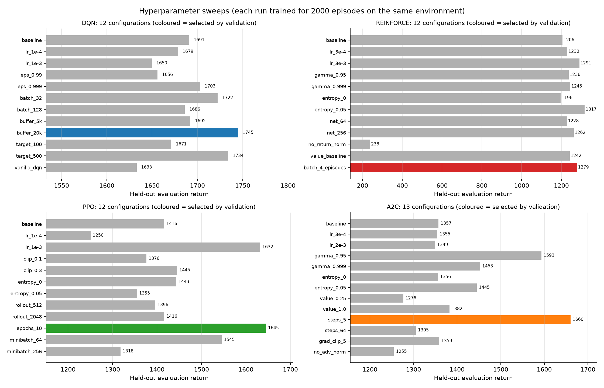

**What the sweeps showed:**

* **DQN** was stable across almost every setting (1633 to 1745). A bigger replay buffer (20k) helped most. Turning double DQN off was worst (1633), because plain DQN overestimates Q-values.
* **REINFORCE** fell apart without return normalisation (238). That run shows its high variance most clearly. More episodes per update and more entropy helped a little.
* **PPO** improved from 1416 to 1645 with **10 epochs per update** and from 1416 to 1632 with a higher learning rate (1e-3). Both make better use of each rollout. Large minibatches (256) hurt.
* **A2C** liked **short rollouts** (5 steps: 1660) and a lower γ (0.95: 1593). Long rollouts (64 steps) and no advantage normalisation were the worst.

## Results

Best run per algorithm, scored on 20 held-out seeds:

| Agent | Best run | Return (standard) | On time | Return (rainy season) | On time (rain) | 3-seed robustness |
|---|---|---|---|---|---|---|
| **DQN** | `dqn_09_buffer_20k` | **1745 ± 92** | **95.0%** | **1702** | **90.9%** | 1722 ± 20 |
| A2C | `a2c_10_steps_5` | 1660 ± 99 | 94.5% | 1566 | 89.1% | 1642 ± 20 |
| PPO | `ppo_10_epochs_10` | 1645 ± 97 | 94.8% | 1605 | 89.4% | 1626 ± 16 |
| REINFORCE | `reinforce_12_batch_4_episodes` | 1279 ± 111 | 85.7% | 1202 | 79.2% | 1176 ± 108 |
| *Nearest-ambulance rule* | — | *1770 ± 88* | *96.6%* | *1742* | *92.3%* | — |
| *Random valid action* | — | *1196 ± 159* | *84.5%* | *1086* | *75.6%* | — |

**Reading the results honestly:**

* **DQN is the best learner.** It beats random by about 550 points, stays above 90% on time in the rainy season, and is stable across training seeds (±20).
* **All agents except REINFORCE come close to the nearest-ambulance rule, but none beats it.** On this map the closest valid ambulance is a very strong policy. DQN gets within about 25 points of it while learning everything from reward alone.
* **REINFORCE is the weakest and least stable** (±108 across seeds). Monte-Carlo returns over a 50-decision episode are noisy.
* **Rain hurts everyone** (40 to 100 points), mostly because murram and rough roads drop to 60% and 40% speed.

### Figures

| | |
|---|---|
| 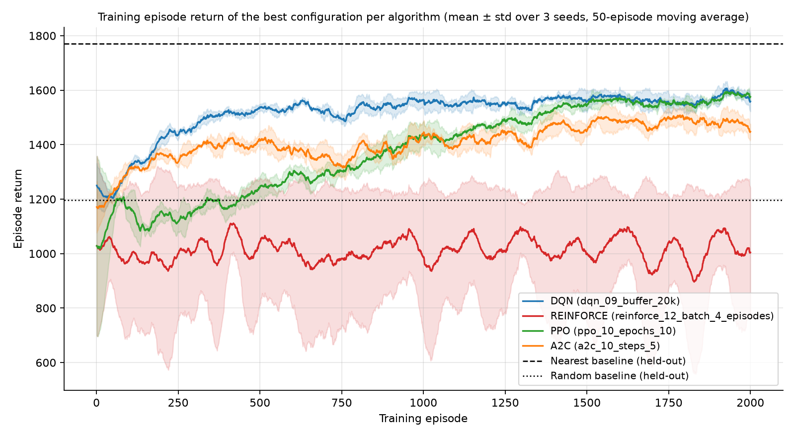 | 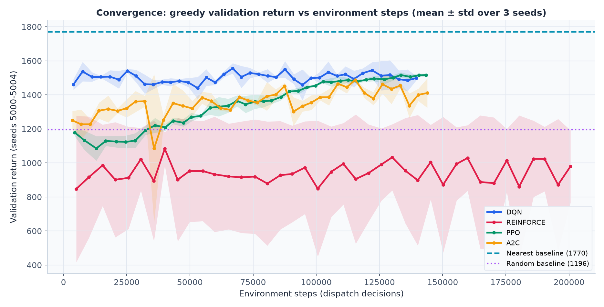 |
| *Training return of each best configuration (mean ± std over 3 seeds). DQN climbs fastest, PPO catches up by episode 1500, REINFORCE stays noisy around 1000.* | *Greedy validation return against environment steps (3 seeds). DQN is strong early; PPO and A2C improve steadily.* |
| 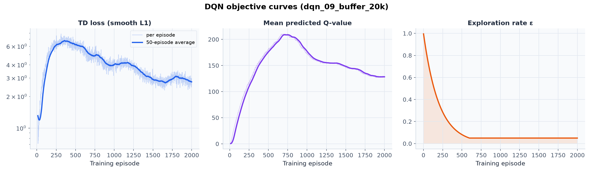 | 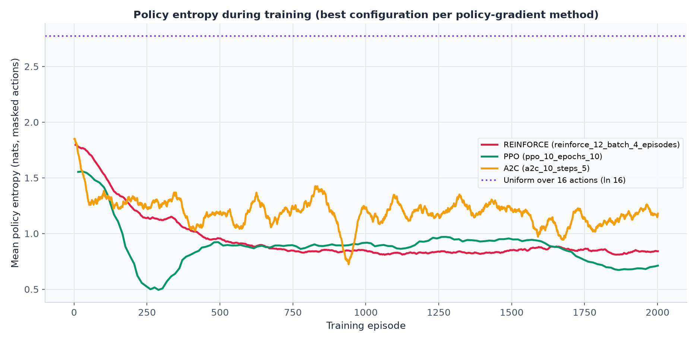 |
| *DQN TD loss, mean predicted Q-value and ε-decay. The Q-value peaks near episode 700 and then settles as overestimation is corrected.* | *Policy entropy for REINFORCE, PPO and A2C* |
| 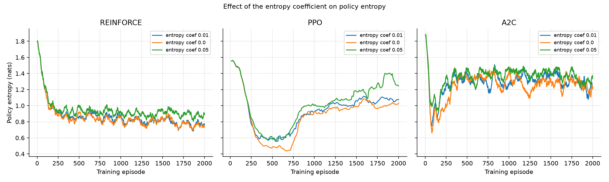 | 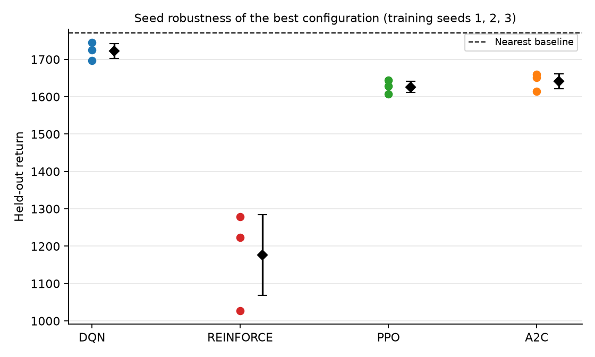 |
| *Effect of the entropy coefficient (0, 0.01, 0.05)* | *Best configuration retrained with seeds 1, 2, 3* |

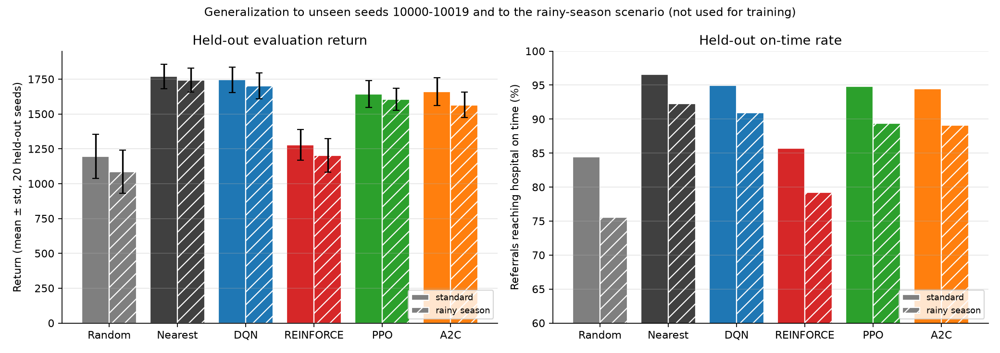
*Held-out return and on-time rate on unseen seeds, standard vs rainy season.*

## HTTP API

The same FastAPI server that powers the 3D view can be used by any other app (a dashboard, a mobile app or a hospital system). Start it with `uv run main.py --no-browser`.

| Method | Route | Purpose |
|---|---|---|
| `GET` | `/api/state` | full state: clock, weather, ambulances with positions and routes, hospital beds and units, referrals, action mask, last decision, metrics, event log |
| `POST` | `/api/reset` | new episode: `{"policy": "dqn", "scenario": "standard", "seed": 10000}` |
| `POST` | `/api/step` | let the agent decide, or send `{"action": 4}` to make your own choice (`manual` policy) |
| `GET` | `/api/policies` | available agents and which trained run each uses |
| `GET` | `/api/scenarios` | `standard`, `rainy_season` |
| `GET` | `/api/comparison` | the final comparison (`logs/comparison.json`) |
| `GET` | `/api/figures` | list of figures in `assets/` |

```bash
curl -X POST http://127.0.0.1:8000/api/reset -H "Content-Type: application/json" \
     -d '{"policy": "dqn", "scenario": "rainy_season", "seed": 10003}'
curl -X POST http://127.0.0.1:8000/api/step -H "Content-Type: application/json" -d '{}'
```

Trained models are saved as PyTorch state dicts in `models/dqn/` and `models/pg/`. The best run per algorithm is listed in `models/best_models.json`, and the server loads models from there.

## Project structure

```
james_mukunzi_rl_summative/
├── pyproject.toml            # dependencies, managed by uv
├── uv.lock
├── README.md
├── main.py                   # entry point: simulate, terminal, baselines, train-dqn, train-pg, compare
├── environment/
│   ├── __init__.py
│   ├── custom_env.py         # MaternalReferralEnv (Gymnasium)
│   ├── rendering.py          # FastAPI server, agent session, terminal log
│   └── web/                  # Three.js 3D frontend (index.html, app.js, scene.js, style.css)
├── training/
│   ├── __init__.py
│   ├── common.py             # TorchRL GymWrapper, seeds, shared helpers
│   ├── dqn_training.py       # DQN and its 12 experiments
│   ├── pg_training.py        # REINFORCE, PPO, A2C and their experiments
│   ├── evaluation.py         # held-out evaluation and baselines
│   ├── compare.py            # best-model selection and seed robustness
│   └── plots.py              # every figure in assets/
├── models/
│   ├── dqn/                  # trained DQN runs (.pt)
│   ├── pg/                   # trained REINFORCE, PPO and A2C runs (.pt)
│   └── best_models.json
├── logs/                     # summary.csv per algorithm, per-run curves, comparison.json, baselines.json
├── assets/                   # figures and environment screenshots
└── tests/                    # environment, training, evaluation and rendering tests
```

## Limitations

* **Synthetic district.** The map, bed numbers, outage rates and road speeds are realistic, but they are not taken from one real district. They would need calibration with real referral records before any real use.
* **One decision at a time.** The agent handles the highest-priority waiting referral first. It cannot reassign an ambulance that is already on the road.
* **The nearest-ambulance rule is still slightly better.** The learned agents match a strong expert rule but don't beat it yet. Longer training, or giving the agent forecasts of upcoming demand, are the natural next steps.
* **Decision support, not a replacement.** In practice, the agent's choice and its Q-values would be shown to a human dispatcher, who makes the final call.
